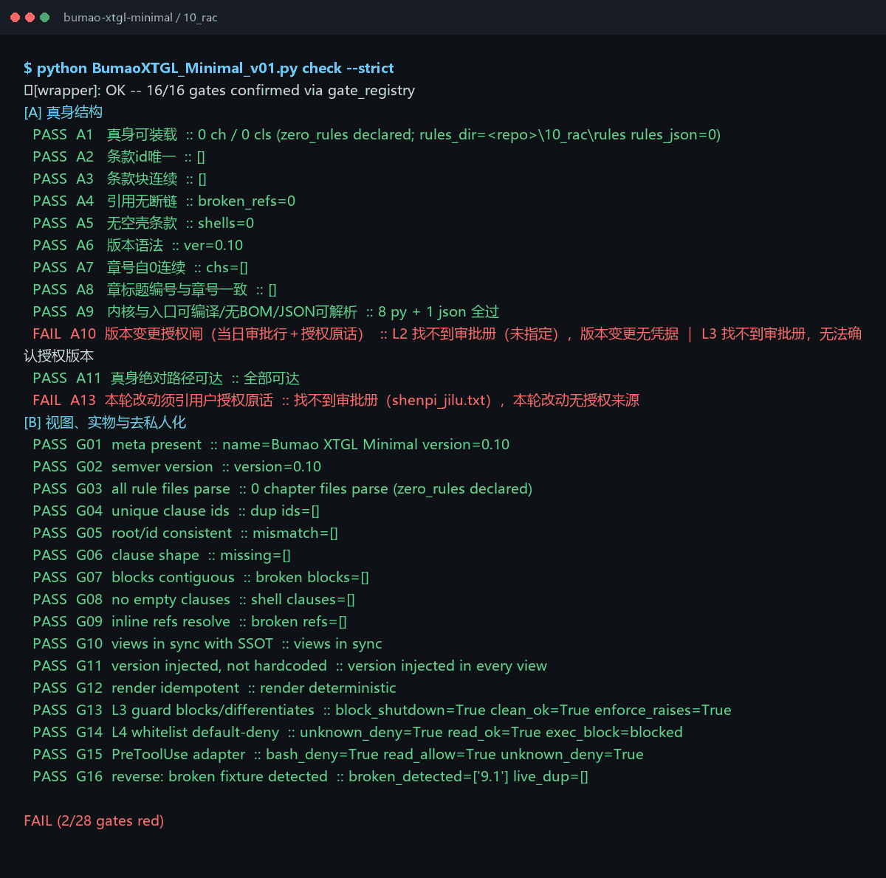
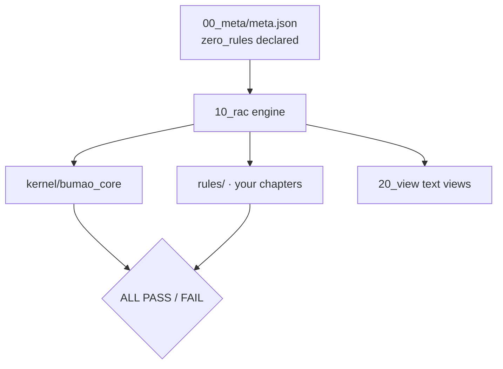
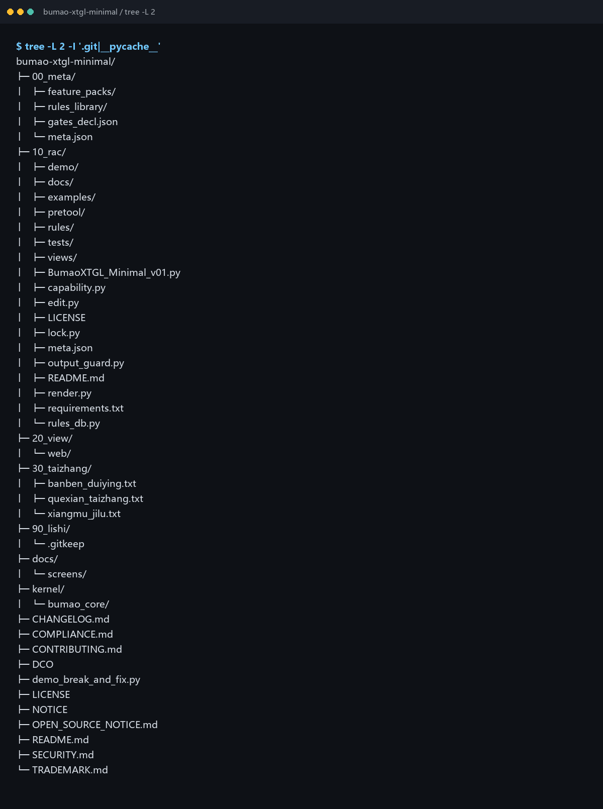

# Bumao XTGL · Minimal

Status: maintenance pause
状态：维护暂停，稳定可用


> **Two version spaces** — the in-app version in `00_meta/meta.json` is `0.10`; the repository release tag is `v0.15`. They are two independent numbering spaces, not the same number.
> **两个版本空间** — 应用内版本（`00_meta/meta.json`）是 `0.10`；仓库发布 tag 是 `v0.15`。这是两个独立的编号空间，不是同一个数字。
>
> **Cold start** — to resume iteration, start from [`RETURN_HERE.md`](RETURN_HERE.md).
> **冷启动** — 恢复迭代从 [`RETURN_HERE.md`](RETURN_HERE.md) 开始。

Zero-rule skeleton of Bumao XTGL: 28 structural checks, your rules, stdlib only. Start here if you want to write your own rule set.

**What it is** — the smallest edition: structure and verdict engine, no rules.
**Who it's for** — people who already have rules of their own and only want the machinery.
**What it solves** — the cost of building a compliance skeleton from zero.


*Real output of `check --strict` on a fresh clone (2/28 red: A10/A13 — without an approval ledger both are explicitly denied (DENY), so FAIL, not PASS).*

## Quick start (30 seconds)

```bash
git clone -b v0.15 https://github.com/Bumao-Ai/Bumao-xtgl-minimal.git
cd Bumao-xtgl-minimal/10_rac
python BumaoXTGL_Minimal_v01.py whoami
python BumaoXTGL_Minimal_v01.py check --strict   # exit code is the verdict
```

Add your rules by dropping chapter files into `10_rac/` and following the loader in `rules_db.py`; `render.py` regenerates the views. `zero_rules` is declared in `00_meta/meta.json`, so the skeleton passes without inventing content.

`v0.15` is the tag this README was released with; see Releases and verify the zip with `SHA256SUMS`.

## Proof of work

| Item | Value | Source |
|---|---|---|
| Commits at `v0.15` | 13 | `git rev-list --count v0.15` |
| Last commit | 2026-11-08 | `git log -1 --date=short` |
| Rules | 0 (declared) | `check --strict` → `0 ch / 0 cls (zero_rules declared)` |
| Check items | 28 | `check --strict` conclusion (`2/28 gates red`) |
| Reverse cases | 5 | `10_rac/tests/test_reverse.py`; last run 5/5 pass |
| Defect ledger | 0 real closed items | `30_taizhang/quexian_taizhang.txt` holds 2 sanitized sample rows |
| Adapter cases | 10 | `10_rac/tests/test_pretool.py`; last run 10/10 pass (incl. bound-token refusal) |
| Releases | 7 tags, `v0.1` → `v0.15`, all 2026-11-08 | `git tag` |
| Changelog | [CHANGELOG.md](CHANGELOG.md) | — |

`A10` and `A13` are red on a public clone by design: they check an approval ledger and a quoted authorization, and this edition ships no approval samples. Without a ledger they are **explicitly denied (DENY)** — the result is FAIL, never PASS. "Red by design" means no same-day authorization credential ships here; it is not a waiver. Older kernels word the detail as "找不到审批册", the current kernel writes "A10 判定=DENY" — both are FAIL.

## 中文

- **是什么**：不带规则的最小发行版（骨架）。
- **给谁用**：已有自己的规矩、只要判定引擎与结构的人。
- **解决什么**：从零搭一套合规骨架的成本。

快速开始沿用上方命令块。`A10／A13` 在没有审批册时**显式判拒（DENY）**：本版不带审批样本，所以它们红着，结果是 FAIL 而不是 PASS；「按设计红」只指公开仓不随附当日授权凭据，不等于豁免。旧内核 detail 写「找不到审批册」，新内核写「A10 判定=DENY」，两者都是 FAIL。

## Roadmap (0.2 — in progress)

1. **执行前约束** — 动手前提交意图，由内核先判。设计与沙盒原型已通，**未接入 live**。*（进行中）*
2. **执行中监管** — 过程中持续检查，而不是只在结束时判一次。设计与沙盒原型已通，**未接入 live**。*（进行中）*
3. **执行后审计** — 把操作、依据、结果、异常四者关联成一条可追溯链。设计与沙盒原型已通，**未接入 live**。*（进行中）*

Status: **in progress**。设计与沙盒原型已通，live 尚未接入；本节不声称已交付。

## Architecture



## What gets checked

| Group | Checks | What it proves |
|---|---|---|
| Source structure | A1–A11, A13 | loader runs, IDs unique, blocks contiguous, references resolve, no empty clauses, entry compiles |
| Authorization | A10, A13 | approval ledger and quoted authorization; without a ledger → explicit **DENY** (FAIL), not a waiver |
| Kernel gates | G01–G09 | meta present, semver, rule files parse, IDs unique and consistent, clause shape, blocks, references |
| Views and guards | G10–G16 | views in sync, version injected, render idempotent, L3/L4 guards and adapter behave, reverse fixture detected |

Total: 12 structure checks + 16 kernel checks = **28 checks**.

## Layout


*Real tree of the shipped repository.*

```
00_meta/      meta.json (zero_rules, version)
10_rac/       engine entry, render.py, rules_db.py, rules/
20_view/      generated views
30_taizhang/  ledgers and baselines
90_lishi/     history
kernel/       bundled bumao_core
docs/screens/ screenshots used in this README
```

## Docs / License

- Changelog: [`CHANGELOG.md`](CHANGELOG.md)
- Contributing: [`CONTRIBUTING.md`](CONTRIBUTING.md) · DCO: [`DCO`](DCO)
- Security: [`SECURITY.md`](SECURITY.md)
- License: Apache-2.0, see [`LICENSE`](LICENSE)
- Trademark boundary: [`TRADEMARK.md`](TRADEMARK.md)

Copyright 2026 Bumao
