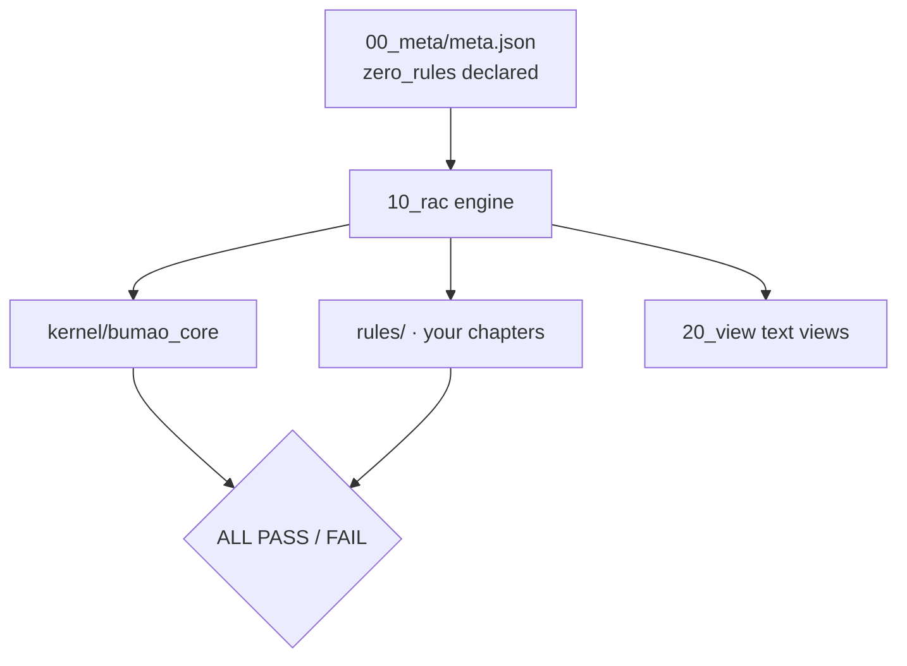

# Bumao XTGL · Minimal
[](https://hub.xerj.org/contributors/Bumao-Ai)
Status: maintenance pause
状态：维护暂停，稳定可用

> **Maintenance pause** — this line is written in every release. Which release counts as the final paused one is not decided yet, so releases continue at irregular intervals.
> **维护暂停** — 这一行每版照写。哪一版才算最终暂停版尚未确定，因此仍按不定时更新发布。


> **Two version spaces** — the in-app version in `00_meta/meta.json` is `0.34`; the repository release tag is `v0.22`. They are two independent numbering spaces, not the same number.
> **两个版本空间** — 应用内版本（`00_meta/meta.json`）是 `0.34`；仓库发布 tag 是 `v0.22`。这是两个独立的编号空间，不是同一个数字。
>
> **Cold start** — to resume iteration, start from [`RETURN_HERE.md`](RETURN_HERE.md).
> **冷启动** — 恢复迭代从 [`RETURN_HERE.md`](RETURN_HERE.md) 开始。

Zero-rule skeleton of Bumao XTGL: 28 structural checks, your rules, stdlib only. Start here if you want to write your own rule set.

**What it is** — the smallest edition: structure and verdict engine, no rules.
**Who it's for** — people who already have rules of their own and only want the machinery.
**What it solves** — the cost of building a compliance skeleton from zero.


*Real output of `check --strict` on a fresh clone (1/28 red: A10 — the shipped ledger template has zero entries, so it prints an explicit DENY, FAIL not PASS).*

## Quick start (30 seconds)

```bash
git clone -b v0.22 https://github.com/Bumao-Ai/Bumao-xtgl-minimal.git
cd Bumao-xtgl-minimal/10_rac
python BumaoXTGL_Minimal_v01.py whoami
python BumaoXTGL_Minimal_v01.py check --strict   # exit code is the verdict
```

Add your rules by dropping chapter files into `10_rac/` and following the loader in `rules_db.py`; `render.py` regenerates the views. `zero_rules` is declared in `00_meta/meta.json`, so the skeleton passes without inventing content.

`v0.22` is the tag this README was released with; see Releases and verify the zip with `SHA256SUMS`.

## Proof of work

| Item | Value | Source |
|---|---|---|
| Commits at `v0.22` | — | 远端由 API 合成提交，本地与远端计数不同，不虚标 |
| Last commit | 2026-11-09 | `git log -1 --date=short` |
| Rules | 0 (declared) | `check --strict` → `0 ch / 0 cls (zero_rules declared)` |
| Check items | 28 | `check --strict` conclusion (`ALL PASS`, A 12 + B 16) |
| Reverse cases | 5 | `10_rac/tests/test_reverse.py`; last run 5/5 pass |
| Defect ledger | 0 real closed items | `30_taizhang/quexian_taizhang.txt` holds 2 sanitized sample rows |
| Adapter cases | 10 | `10_rac/tests/test_pretool.py`; last run 10/10 pass (incl. bound-token refusal) |
| Releases | 14 tags, `v0.1` → `v0.22`, 2026-11-08 → 2026-11-09 | `git tag` |
| Changelog | [CHANGELOG.md](CHANGELOG.md) | — |

`A10` passes while the shipped `30_taizhang/shenpi_jilu.txt` carries a same-day authorized entry. This edition ships that file with 10 entries dated 2026-11-09, so a clone of this tag passes `A10` (state `changed`: the version contract changed that day and a same-day entry covers it). If you replace the file with an empty template, `A10` becomes an explicit **DENY** — the result is FAIL, never PASS; the pass is carried by the shipped entries, not by a waiver.

## 中文

- **是什么**：不带规则的最小发行版（骨架）。
- **给谁用**：已有自己的规矩、只要判定引擎与结构的人。
- **解决什么**：从零搭一套合规骨架的成本。

快速开始沿用上方命令块。`A10` 在没有当日授权条目时**显式判拒（DENY）**：本版随包的审批册是零条目结构模板，所以它红着，结果是 FAIL 而不是 PASS；「按设计红」只指公开仓不随附当日授权凭据，不等于豁免。detail 首段写 `A10 判定=DENY` 并标明策略 `deny`。

## Roadmap (0.2 — live in the maintainer's edition; not shipped here)

1. **Pre-execution constraint** — state the intent before acting; the kernel rules first. *Replayed on all three live editions on 2026-11-09: no order → reject, expired order → reject, out-of-scope target → reject, compliant order → pass (5/5 cases per edition). The supervisor is not bundled with this repository, so package behaviour stays `off`.*
2. **Mid-execution supervision** — check while the work runs, not once at the end. *Replayed on 2026-11-09: action-level records (`op_id` / target / result), plus a real mid-sequence halt — an out-of-order change made while the sequence runs interrupts the next action with an `EXTERNAL_DRIFT` evidence bundle (`halt.json` / `diff.txt` / ledger snapshot / `manifest.sha256`), and work resumes only after recover plus a human approval. Bypassing the entry is recorded as post-hoc searchable only, never counted as covered. This round was re-run on the community and minimal live editions; the personal edition keeps its earlier same-day drill evidence and was not re-run.*
3. **Post-hoc audit** — link operation, basis, result and exception into one traceable chain. *One command exports the full chain from any `op_id` on all three live editions (2026-11-09); `rule_id` / `run_id` / `error_code` sit on the ticket face.*

Status: **landed in the maintainer's live edition** — all three 0.2 items were replayed on the three live editions on 2026-11-09, including this edition in its live tree. This repository is a desensitized template: the supervisor is not bundled, `BUMO_JIANCHA_MODE` stays `off`, and nothing here claims the items ran inside this package.

## Architecture



## What gets checked

| Group | Checks | What it proves |
|---|---|---|
| Source structure | A1–A11, A13 | loader runs, IDs unique, blocks contiguous, references resolve, no empty clauses, entry compiles |
| Authorization | A10, A13 | approval ledger and quoted authorization; without a ledger → explicit **DENY** (FAIL), not a waiver |
| Kernel gates | G01–G09 | meta present, semver, rule files parse, IDs unique and consistent, clause shape, blocks, references |
| Views and guards | G10–G16 | views in sync, version injected, render idempotent, L3/L4 guards and adapter behave, reverse fixture detected |

Total: 12 structure checks + 16 kernel checks = **28 checks**.

## Layout


*Real tree of the shipped repository.*

```
00_meta/      meta.json (zero_rules, version)
10_rac/       engine entry, render.py, rules_db.py, rules/
20_view/      generated views
30_taizhang/  ledgers and baselines
90_lishi/     history
kernel/       bundled bumao_core
docs/screens/ screenshots used in this README
```

## Docs / License

- Changelog: [`CHANGELOG.md`](CHANGELOG.md)
- Contributing: [`CONTRIBUTING.md`](CONTRIBUTING.md) · DCO: [`DCO`](DCO)
- Security: [`SECURITY.md`](SECURITY.md)
- License: Apache-2.0, see [`LICENSE`](LICENSE)
- Trademark boundary: [`TRADEMARK.md`](TRADEMARK.md)

Copyright 2026 Bumao

---

# Bumao XTGL · Minimal（中文）

状态：维护暂停，稳定可用


> **两个版本空间** — 应用内版本（`00_meta/meta.json`）是 `0.34`；仓库发布 tag 是 `v0.22`。这是两个独立的编号空间，不是同一个数字。
>
> **冷启动** — 恢复迭代从 [`RETURN_HERE.md`](RETURN_HERE.md) 开始。

零规则的 Bumao XTGL 骨架：28 道结构检查、规则由你写、只用标准库。想自己写规则集的人从这里开始。

**是什么** — 最小发行版：结构与判定引擎，不带规则。
**给谁用** — 已有自己的规矩、只要这套机制的人。
**解决什么** — 从零搭一套合规骨架的成本。


*全新克隆上 `check --strict` 的真实输出（1/28 红：A10——随包审批册是零条目模板，所以显式判拒，结果是 FAIL 而不是 PASS）。*

## 快速开始（30 秒）

```bash
git clone -b v0.22 https://github.com/Bumao-Ai/Bumao-xtgl-minimal.git
cd Bumao-xtgl-minimal/10_rac
python BumaoXTGL_Minimal_v01.py whoami
python BumaoXTGL_Minimal_v01.py check --strict   # 退出码即结论
```

往 `10_rac/` 里丢章文件即添加规则，并按 `rules_db.py` 的装载方式对齐；`render.py` 重新生成视图。`zero_rules` 在 `00_meta/meta.json` 中声明，所以骨架无需编造内容即可通过。

`v0.22` 是本 README 随附发布的 tag；见 Releases，并用 `SHA256SUMS` 校验 zip。

## 工作留痕

| 项 | 实测值 | 取值来源 |
|---|---|---|
| `v0.22` 处的提交数 | — | 远端由 API 合成提交，本地与远端计数不同，不虚标 |
| 最近提交 | 2026-11-09 | `git log -1 --date=short` |
| 规则 | 0（已声明） | `check --strict` → `0 ch / 0 cls (zero_rules declared)` |
| 检查项 | 28 | `check --strict` 结论行（`ALL PASS`，A段 12 项 + B段 16 项） |
| 反向用例 | 5 | `10_rac/tests/test_reverse.py`；最近一次 5/5 通过 |
| 缺陷台账 | 0 条真实闭环 | `30_taizhang/quexian_taizhang.txt` 仅 2 行脱敏样例 |
| 适配器用例 | 10 | `10_rac/tests/test_pretool.py`；最近一次 10/10 通过（含绑定令牌拒绝） |
| 发布 | 14 个 tag，`v0.1` → `v0.22`，2026-11-08 → 2026-11-09 | `git tag` |
| 变更记录 | [CHANGELOG.md](CHANGELOG.md) | — |

`A10` 的通过条件是随包 `30_taizhang/shenpi_jilu.txt` 里有当日的授权条目。本版随附该文件 10 条 2026-11-09 条目，因此克隆本 tag 后 `A10` 为 PASS（三态 `changed`：契约当日变更，当日条目覆盖）。若把该文件换成空模板，`A10` 即显式判拒（DENY）——结果是 FAIL，绝不是 PASS；通过凭的是随附条目，不是豁免。

## Roadmap（0.2 — 维护者活区已落地，本仓不随附）

1. **执行前约束** — 动手前提交意图，由内核先判。*2026-11-09 在维护者活区三端复跑：无单→拒、过期单→拒、出界目标→拒、合规单→放行，每端 5/5 用例全过。随包不附监督执行器，本仓行为保持 `off`。*
2. **执行中监管** — 过程中持续检查，而不是只在结束时判一次。*2026-11-09 复跑：动作级记录（`op_id`／目标／结果）＋真实的中途越界中断——序列还在跑时有人在单外改动，下一次动作前即以 `EXTERNAL_DRIFT` 中断并生成证据包（`halt.json`／`diff.txt`／账本快照／`manifest.sha256`），恢复须先 recover 再经人工批准 resume 才能继续。绕过入口只记为「仅事后可查」，不计入已覆盖。本轮在 community、minimal 活区复跑；personal 沿用当日早间演练留证，未重跑。*
3. **执行后审计** — 把操作、依据、结果、异常四者关联成一条可追溯链。*任一 `op_id` 一条命令导出完整链路（2026-11-09 三端复跑）；`rule_id`／`run_id`／`error_code` 落在票面。*

状态：**维护者活区已落地** —— 2026-11-09 三项在维护者活区三端复跑（含本端活区）。本仓是脱敏模板，不随附监督执行器，`BUMO_JIANCHA_MODE` 保持 `off`；本节不声称这些在本仓跑过。

## 架构

（图示沿用上方 mermaid 流程：`00_meta/meta.json`（zero_rules）→ `10_rac` 引擎 ← 你的章文件；引擎 → `kernel/bumao_core` 与文本视图 → `ALL PASS` / `FAIL`。）

## 检查什么

| 组 | 检查 | 证明了什么 |
|---|---|---|
| 源结构 | A1–A11、A13 | 装载器可运行、ID 唯一、块连续、引用可解析、无空条款、入口可编译 |
| 授权 | A10、A13 | 审批台账与引用式授权；无台账 → 显式 **DENY**（FAIL），不是豁免 |
| 内核闸门 | G01–G09 | meta 存在、semver 合规、规则文件可解析、ID 唯一一致、条款形态、块、引用 |
| 视图与守卫 | G10–G16 | 视图同步、版本注入、渲染幂等、L3/L4 守卫与适配器行为、反向样本可检出 |

合计：12 道结构检查 + 16 道内核检查 = **28 道检查**。

## 目录


*本仓真实的目录树。*

```text
00_meta/      meta.json（zero_rules、version）
10_rac/       引擎入口、render.py、rules_db.py、rules/
20_view/      生成的视图
30_taizhang/  台账与基线
90_lishi/     历史
kernel/       随包 bumao_core
docs/screens/ 本 README 用到的截图
```

## 文档与许可

- 变更记录：[`CHANGELOG.md`](CHANGELOG.md)
- 参与贡献：[`CONTRIBUTING.md`](CONTRIBUTING.md) · DCO：[`DCO`](DCO)
- 安全策略：[`SECURITY.md`](SECURITY.md)
- 许可：Apache-2.0，见 [`LICENSE`](LICENSE)
- 商标边界：[`TRADEMARK.md`](TRADEMARK.md)

Copyright 2026 Bumao
