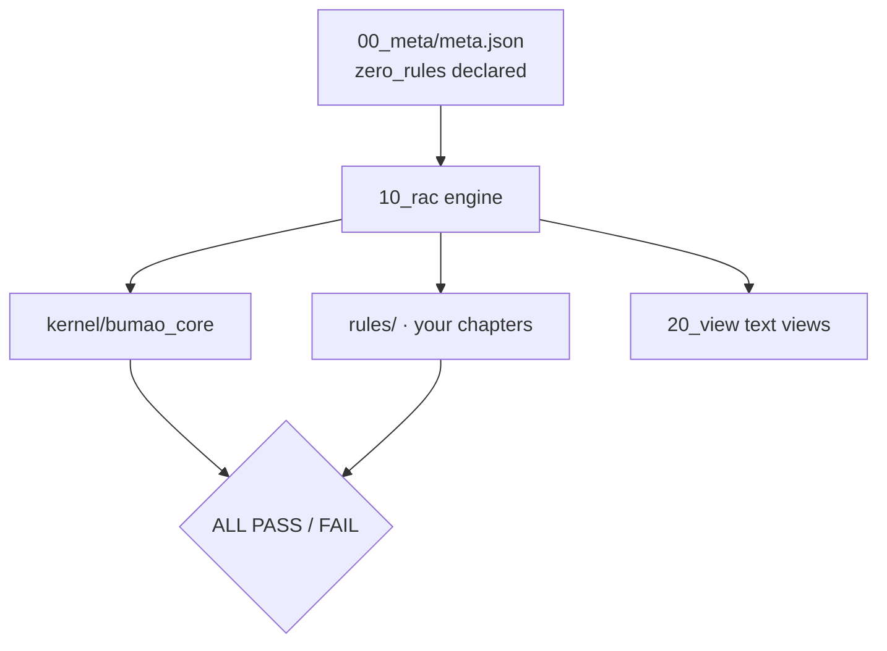

# Bumao XTGL · Minimal

Status: maintenance pause
状态：维护暂停，稳定可用


> **Two version spaces** — the in-app version in `00_meta/meta.json` is `0.30`; the repository release tag is `v0.19`. They are two independent numbering spaces, not the same number.
> **两个版本空间** — 应用内版本（`00_meta/meta.json`）是 `0.30`；仓库发布 tag 是 `v0.19`。这是两个独立的编号空间，不是同一个数字。
>
> **Cold start** — to resume iteration, start from [`RETURN_HERE.md`](RETURN_HERE.md).
> **冷启动** — 恢复迭代从 [`RETURN_HERE.md`](RETURN_HERE.md) 开始。

Zero-rule skeleton of Bumao XTGL: 28 structural checks, your rules, stdlib only. Start here if you want to write your own rule set.

**What it is** — the smallest edition: structure and verdict engine, no rules.
**Who it's for** — people who already have rules of their own and only want the machinery.
**What it solves** — the cost of building a compliance skeleton from zero.


*Real output of `check --strict` on a fresh clone (1/28 red: A10 — the shipped ledger template has zero entries, so it prints an explicit DENY, FAIL not PASS).*

## Quick start (30 seconds)

```bash
git clone -b v0.18 https://github.com/Bumao-Ai/Bumao-xtgl-minimal.git
cd Bumao-xtgl-minimal/10_rac
python BumaoXTGL_Minimal_v01.py whoami
python BumaoXTGL_Minimal_v01.py check --strict   # exit code is the verdict
```

Add your rules by dropping chapter files into `10_rac/` and following the loader in `rules_db.py`; `render.py` regenerates the views. `zero_rules` is declared in `00_meta/meta.json`, so the skeleton passes without inventing content.

`v0.19` is the tag this README was released with; see Releases and verify the zip with `SHA256SUMS`.

## Proof of work

| Item | Value | Source |
|---|---|---|
| Commits at `v0.19` | — | 远端由 API 合成提交，本地与远端计数不同，不虚标 |
| Last commit | 2026-11-09 | `git log -1 --date=short` |
| Rules | 0 (declared) | `check --strict` → `0 ch / 0 cls (zero_rules declared)` |
| Check items | 28 | `check --strict` conclusion (`1/28 gates red`) |
| Reverse cases | 5 | `10_rac/tests/test_reverse.py`; last run 5/5 pass |
| Defect ledger | 0 real closed items | `30_taizhang/quexian_taizhang.txt` holds 2 sanitized sample rows |
| Adapter cases | 10 | `10_rac/tests/test_pretool.py`; last run 10/10 pass (incl. bound-token refusal) |
| Releases | 11 tags, `v0.1` → `v0.19`, 2026-11-08 → 2026-11-09 | `git tag` |
| Changelog | [CHANGELOG.md](CHANGELOG.md) | — |

`A10` is red on a public clone by design: it needs a same-day authorized entry in `30_taizhang/shenpi_jilu.txt`, and this edition ships that file as a **structure template with zero entries**. With no parseable entry the gate is **explicitly denied (DENY)** — the result is FAIL, never PASS. "Red by design" means no same-day authorization credential ships here; it is not a waiver. The detail line now starts with `A10 判定=DENY` and names the policy (`deny`).

## 中文

- **是什么**：不带规则的最小发行版（骨架）。
- **给谁用**：已有自己的规矩、只要判定引擎与结构的人。
- **解决什么**：从零搭一套合规骨架的成本。

快速开始沿用上方命令块。`A10` 在没有当日授权条目时**显式判拒（DENY）**：本版随包的审批册是零条目结构模板，所以它红着，结果是 FAIL 而不是 PASS；「按设计红」只指公开仓不随附当日授权凭据，不等于豁免。detail 首段写 `A10 判定=DENY` 并标明策略 `deny`。

## Roadmap (0.2 — in progress)

1. **执行前约束** — 动手前提交意图，由内核先判。设计与沙盒原型已通，**未接入 live**。*（进行中）*
2. **执行中监管** — 过程中持续检查，而不是只在结束时判一次。设计与沙盒原型已通，**未接入 live**。*（进行中）*
3. **执行后审计** — 把操作、依据、结果、异常四者关联成一条可追溯链。设计与沙盒原型已通，**未接入 live**。*（进行中）*

Status: **in progress**。设计与沙盒原型已通，live 尚未接入；本节不声称已交付。

## Architecture



## What gets checked

| Group | Checks | What it proves |
|---|---|---|
| Source structure | A1–A11, A13 | loader runs, IDs unique, blocks contiguous, references resolve, no empty clauses, entry compiles |
| Authorization | A10, A13 | approval ledger and quoted authorization; without a ledger → explicit **DENY** (FAIL), not a waiver |
| Kernel gates | G01–G09 | meta present, semver, rule files parse, IDs unique and consistent, clause shape, blocks, references |
| Views and guards | G10–G16 | views in sync, version injected, render idempotent, L3/L4 guards and adapter behave, reverse fixture detected |

Total: 12 structure checks + 16 kernel checks = **28 checks**.

## Layout


*Real tree of the shipped repository.*

```
00_meta/      meta.json (zero_rules, version)
10_rac/       engine entry, render.py, rules_db.py, rules/
20_view/      generated views
30_taizhang/  ledgers and baselines
90_lishi/     history
kernel/       bundled bumao_core
docs/screens/ screenshots used in this README
```

## Docs / License

- Changelog: [`CHANGELOG.md`](CHANGELOG.md)
- Contributing: [`CONTRIBUTING.md`](CONTRIBUTING.md) · DCO: [`DCO`](DCO)
- Security: [`SECURITY.md`](SECURITY.md)
- License: Apache-2.0, see [`LICENSE`](LICENSE)
- Trademark boundary: [`TRADEMARK.md`](TRADEMARK.md)

Copyright 2026 Bumao

---

# Bumao XTGL · Minimal（中文）

状态：维护暂停，稳定可用


> **两个版本空间** — 应用内版本（`00_meta/meta.json`）是 `0.30`；仓库发布 tag 是 `v0.19`。这是两个独立的编号空间，不是同一个数字。
>
> **冷启动** — 恢复迭代从 [`RETURN_HERE.md`](RETURN_HERE.md) 开始。

零规则的 Bumao XTGL 骨架：28 道结构检查、规则由你写、只用标准库。想自己写规则集的人从这里开始。

**是什么** — 最小发行版：结构与判定引擎，不带规则。
**给谁用** — 已有自己的规矩、只要这套机制的人。
**解决什么** — 从零搭一套合规骨架的成本。


*全新克隆上 `check --strict` 的真实输出（1/28 红：A10——随包审批册是零条目模板，所以显式判拒，结果是 FAIL 而不是 PASS）。*

## 快速开始（30 秒）

```bash
git clone -b v0.18 https://github.com/Bumao-Ai/Bumao-xtgl-minimal.git
cd Bumao-xtgl-minimal/10_rac
python BumaoXTGL_Minimal_v01.py whoami
python BumaoXTGL_Minimal_v01.py check --strict   # 退出码即结论
```

往 `10_rac/` 里丢章文件即添加规则，并按 `rules_db.py` 的装载方式对齐；`render.py` 重新生成视图。`zero_rules` 在 `00_meta/meta.json` 中声明，所以骨架无需编造内容即可通过。

`v0.19` 是本 README 随附发布的 tag；见 Releases，并用 `SHA256SUMS` 校验 zip。

## 工作留痕

| 项 | 实测值 | 取值来源 |
|---|---|---|
| `v0.19` 处的提交数 | — | 远端由 API 合成提交，本地与远端计数不同，不虚标 |
| 最近提交 | 2026-11-09 | `git log -1 --date=short` |
| 规则 | 0（已声明） | `check --strict` → `0 ch / 0 cls (zero_rules declared)` |
| 检查项 | 28 | `check --strict` 结论行（`1/28 gates red`） |
| 反向用例 | 5 | `10_rac/tests/test_reverse.py`；最近一次 5/5 通过 |
| 缺陷台账 | 0 条真实闭环 | `30_taizhang/quexian_taizhang.txt` 仅 2 行脱敏样例 |
| 适配器用例 | 10 | `10_rac/tests/test_pretool.py`；最近一次 10/10 通过（含绑定令牌拒绝） |
| 发布 | 11 个 tag，`v0.1` → `v0.19`，2026-11-08 → 2026-11-09 | `git tag` |
| 变更记录 | [CHANGELOG.md](CHANGELOG.md) | — |

`A10` 在公开克隆上按设计为红：它需要 `30_taizhang/shenpi_jilu.txt` 里有当日的授权条目，而本版把该文件作为**零条目的结构模板**随附。没有可解析条目时，闸门**显式判拒（DENY）**——结果是 FAIL，绝不是 PASS。「按设计红」的意思是本版不随附当日授权凭据，不是豁免。detail 行现在以 `A10 判定=DENY` 开头并标明策略（`deny`）。

## Roadmap（0.2 — 进行中）

1. **执行前约束** — 动手前提交意图，由内核先判。设计与沙盒原型已通，**未接入 live**。*（进行中）*
2. **执行中监管** — 过程中持续检查，而不是只在结束时判一次。设计与沙盒原型已通，**未接入 live**。*（进行中）*
3. **执行后审计** — 把操作、依据、结果、异常四者关联成一条可追溯链。设计与沙盒原型已通，**未接入 live**。*（进行中）*

状态：**进行中**。设计与沙盒原型已通，live 尚未接入；本节不声称已交付。

## 架构

（图示沿用上方 mermaid 流程：`00_meta/meta.json`（zero_rules）→ `10_rac` 引擎 ← 你的章文件；引擎 → `kernel/bumao_core` 与文本视图 → `ALL PASS` / `FAIL`。）

## 检查什么

| 组 | 检查 | 证明了什么 |
|---|---|---|
| 源结构 | A1–A11、A13 | 装载器可运行、ID 唯一、块连续、引用可解析、无空条款、入口可编译 |
| 授权 | A10、A13 | 审批台账与引用式授权；无台账 → 显式 **DENY**（FAIL），不是豁免 |
| 内核闸门 | G01–G09 | meta 存在、semver 合规、规则文件可解析、ID 唯一一致、条款形态、块、引用 |
| 视图与守卫 | G10–G16 | 视图同步、版本注入、渲染幂等、L3/L4 守卫与适配器行为、反向样本可检出 |

合计：12 道结构检查 + 16 道内核检查 = **28 道检查**。

## 目录


*本仓真实的目录树。*

```text
00_meta/      meta.json（zero_rules、version）
10_rac/       引擎入口、render.py、rules_db.py、rules/
20_view/      生成的视图
30_taizhang/  台账与基线
90_lishi/     历史
kernel/       随包 bumao_core
docs/screens/ 本 README 用到的截图
```

## 文档与许可

- 变更记录：[`CHANGELOG.md`](CHANGELOG.md)
- 参与贡献：[`CONTRIBUTING.md`](CONTRIBUTING.md) · DCO：[`DCO`](DCO)
- 安全策略：[`SECURITY.md`](SECURITY.md)
- 许可：Apache-2.0，见 [`LICENSE`](LICENSE)
- 商标边界：[`TRADEMARK.md`](TRADEMARK.md)

Copyright 2026 Bumao
